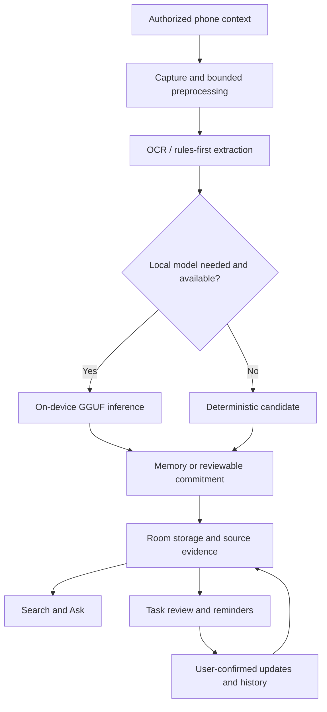

# Retenqo

**Remember what matters. Follow through. Keep personal context local.**

Retenqo is a local-first AI memory and commitment assistant for Android. It turns authorized phone context into searchable, source-backed memories and reviewable commitments, helping people remember important details and act on them without sending their prompts or memories to a cloud AI service.

[Download / Releases](https://github.com/priyanshuchawda/retenqo-enterprise/releases) · [How it works](#how-it-works) · [Build from source](#build-from-source) · [Contribute](#contributing) · [Report an issue](https://github.com/priyanshuchawda/retenqo-enterprise/issues)

[](LICENSE)


> **Development status:** Actively developed Apache-2.0 open-source project. The first official downloadable APK is not yet published. See the implementation report for verified behavior and outstanding work. Production readiness and security assurance are goals, not certifications.

## Why Retenqo?

Important information is scattered across notifications, conversations, screenshots, documents and personal notes. Finding a message later is often easier than remembering the commitment it contained.

Retenqo's focus is **personal memory and follow-through**, in the personal productivity / on-device AI vertical: capture information from sources a person chooses, preserve its evidence, turn actionable context into reviewable commitments, and help the person keep track of what happens next.

Unlike a general-purpose phone autopilot, Retenqo is designed around supported Android APIs, explicit permission controls, source-linked evidence and human approval of uncertain task updates.

## Capabilities

| Capability | What the current implementation provides |
| --- | --- |
| Notification capture | Seven configurable source groups; capture starts paused until sources are enabled. |
| Screenshots and screen context | On-demand MediaProjection capture; optional, bounded Accessibility text context for an explicitly opted-in Ask query. |
| Document and image intake | Android share targets and system pickers for selected text, photos and PDFs; on-device OCR. |
| Personal memory | Local memory cards, lexical retrieval and evidence-linked questions and answers. |
| Commitment tracking | Review, accept, dismiss, edit, complete, snooze and reopen commitments; inspect their decision history. |
| Completion suggestions | Local evidence matching can suggest completion; the user confirms the change. |
| Reminders and widget | Due reminders and a home-screen count of confirmed follow-ups without exposing card text. |
| Local AI | CPU inference through llama.cpp with a compatible imported or downloaded GGUF model. |
| Voice | Tap-to-talk, Whisper native bridge and Android TTS implementation; full device verification is pending. |
| Backup and recovery | Passphrase-encrypted exports and additive restore; older plaintext JSON backups can still be imported. |

The table describes implemented paths, not a claim that every workflow has been fully verified on physical devices.

## How it works



**Approach and logic.** Deterministic rules handle straightforward extraction first. A compatible local model can assist with ambiguous text and candidate completion matching. Retrieval currently uses lexical matching rather than a learned semantic embedding model. The Ask pipeline attempts to ground memory answers in retrieved evidence; the model can still produce incorrect or unsupported output.

**Example workflow (illustrative, not a benchmark):**

1. An enabled notification source receives: “Can you send me the slides by Friday?”
2. Retenqo surfaces a reviewable commitment candidate with available source context.
3. The user reviews and accepts it, then tracks the deadline.
4. Later evidence may suggest that the commitment has been fulfilled.
5. The user confirms or dismisses the suggestion; the decision becomes part of the history.

## Download and installation

Official binaries will be distributed through [GitHub Releases](https://github.com/priyanshuchawda/retenqo-enterprise/releases). Until a release is available, developers can build the debug APK from source.

| Requirement | Current build configuration |
| --- | --- |
| Platform | Android 13+ (API 33+) |
| CPU architecture | ARM64 / arm64-v8a |
| Application version | See the Android Gradle configuration and published release tags when available |
| AI model | Compatible GGUF, downloaded explicitly or imported into app-scoped storage |
| Recommended starting model | Qwen3.5-0.8B Q4_0, 563 MB download |
| Network | Required for model download; local text generation can operate offline after setup |

Install only from a trusted source. Keep Android security protections enabled. Model compatibility and device performance vary; see the [offline model guide](docs/OFFLINE_MODELS.md) for the pinned model source, checksum, license and storage requirements.

## Privacy and security

Retenqo's local-first architecture reduces reliance on external AI services. It is not a claim of complete anonymity, zero risk or application-level encryption of every stored record.

| Access / data | Purpose and boundary |
| --- | --- |
| Notification access | Read notifications only after Android access and source selection; capture starts paused. |
| Screen capture | User-initiated Android MediaProjection consent. |
| Accessibility | Optional service that maintains a bounded, short-lived visible-text snapshot; included in Ask only when explicitly selected for that query. |
| Photos and documents | Scoped media access for optional WhatsApp image discovery; explicit picker/share grants for selected files. No all-files permission. |
| Microphone | Voice capture, subject to Android permission. |
| Local storage | Room memory records and app-scoped model files; Android sandbox protections apply. |
| Internet | Explicit model download; prompts and memories are not sent to a cloud model by the implemented inference path. |
| Backup | New exports use AES-256-GCM with a PBKDF2-HMAC-SHA256-derived key; the passphrase is not stored. Legacy JSON is plaintext. |

Accessibility access is sensitive even when processing is local. Enable it only if the behavior is desired. Do not capture other people's private information without appropriate permission. Keep backups and signing credentials secure.

Read the [security policy](SECURITY.md). For suspected vulnerabilities, use [private vulnerability reporting](https://github.com/priyanshuchawda/retenqo-enterprise/security) if enabled; otherwise contact the maintainer privately. Do not post private messages, notifications, credentials or real memory exports in public issues.

## Technology and architecture

| Layer | Technology |
| --- | --- |
| UI | Kotlin, Jetpack Compose, Material 3 |
| State and concurrency | ViewModel, Kotlin Coroutines, Flow |
| Persistence | Room / SQLite, schema migrations |
| Background processing | WorkManager |
| Capture | NotificationListenerService, MediaProjection, Android share and picker APIs |
| Text recognition | ML Kit |
| Local model runtime | llama.cpp, GGUF, C/C++ and JNI |
| Speech | whisper.cpp and Android TTS |
| Build | Gradle Kotlin DSL, JDK 21, Android SDK 36, NDK |

```text
android/mneme/       Android application and native runtime integration
android/mneme-test/  Experimental / test application
scripts/             Build, native dependency setup and verification
docs/                Implementation, audit, model and design documentation
eval-results/        Evaluation artifacts
pitch-assets/        Presentation and demo assets
```

Presentation assets can include scripted states; they should not be interpreted as independent evidence of real-world AI performance.

## Build from source

### Prerequisites

- Git, Bash and a compatible Linux development environment (or WSL with the necessary Android tooling)
- JDK 21
- Android SDK with platform 36, appropriate build tools, NDK 29.0.14206865 and CMake
- Internet access to provision build dependencies and pinned native sources

```bash
git clone https://github.com/priyanshuchawda/retenqo-enterprise.git
cd retenqo-enterprise
./scripts/build-mneme.sh
```

The build script provisions native dependencies and uses the Gradle wrapper. Set `ANDROID_HOME` and, if needed, `MNEME_JAVA_HOME` to the local installations.

Debug APK: `android/mneme/app/build/outputs/apk/debug/app-debug.apk`

For a connected, authorized Android device:

```bash
adb install -r android/mneme/app/build/outputs/apk/debug/app-debug.apk
```

The debug build has a separate application ID suffix. A release assembly is not automatically a signed, publishable distribution artifact; release signing must be configured securely before publication.

## Testing and engineering evidence

```bash
./scripts/test-mneme.sh
cd android/mneme
./gradlew :app:lintDebug :app:assembleDebug
# Requires a compatible connected Android device:
./gradlew :app:connectedDebugAndroidTest
```

### Documented verification baseline — 25 November 2026

| Check | Reported result |
| --- | --- |
| JVM unit tests | 74 passed |
| Debug assembly | Passed |
| Android Lint | Passed, with 27 non-blocking findings |
| Android crypto instrumentation | 1 passed on Galaxy M32 |
| Offline local generation | A short general question answered with connectivity disabled |
| Room migration | v5 to v7 verified on-device with existing data retained |
| Device observation | Galaxy M32, Android 13 / ARM64; approximately 831 MB process PSS in one model run |

Source: [implementation status](docs/IMPLEMENTATION_STATUS.md). These are historical reported results, not live CI badges, independently reproduced results, or broad performance guarantees.

Engineering priorities include durable capture, source and citation correctness, permission revocation, secure storage, lifecycle management, native resource bounds, reproducible tests and measurable accessibility.

## Known limitations and assumptions

- Local generation requires a compatible installed model and adequate device resources.
- Retrieval is lexical; learned semantic embeddings are not integrated.
- The local model is not a reliable general-purpose autonomous planner. AI output and proposed task updates need human review.
- Broad multilingual extraction, real-world retrieval accuracy, battery and thermal behavior are not yet comprehensively benchmarked.
- Real-device end-to-end capture, voice, reminders, backup restore, permission behavior, and additional device compatibility need further verification.
- New backup exports are encrypted; legacy JSON is not. Backup encryption is distinct from database encryption at rest.
- Manual screen-reader and switch-control testing remains outstanding.
- No official stable release or verified production security certification is currently documented.

See [implementation audit](docs/IMPLEMENTATION_AUDIT.md) and [roadmap](docs/ROADMAP.md) for additional detail.

## Contributing

Contributions, technical review, reproducible bug reports and improvement proposals are welcome. Read [CONTRIBUTING.md](CONTRIBUTING.md), [CODE_OF_CONDUCT.md](CODE_OF_CONDUCT.md) and [AGENTS.md](AGENTS.md) before submitting code.

Good starting areas include Android reliability, coroutine lifecycle, privacy and security, retrieval evaluation, accessibility, test coverage, native performance and documentation.

**Suggested workflow**

1. Check [existing issues](https://github.com/priyanshuchawda/retenqo-enterprise/issues) and open an issue describing the problem, impact and acceptance criteria.
2. Agree on scope, then fork or create a focused branch.
3. Make small, reviewable commits; follow Kotlin conventions and preserve existing data compatibility.
4. Add meaningful regression tests and run the relevant build, lint and test commands.
5. Open a pull request linking the issue. Include implementation rationale, verification output, remaining limitations and screenshots for UI changes.

Never commit credentials, signing keys, personal memory databases, model binaries without distribution rights or real private capture data. Use synthetic test fixtures and redact diagnostics. Security-sensitive changes should include a threat assessment and failure-path tests. Avoid unrelated refactors and do not claim checks passed unless they were actually run.

## Project documentation

| Document | Purpose |
| --- | --- |
| [Architecture](docs/ARCHITECTURE.md) | System boundaries and design direction |
| [Threat model](docs/THREAT_MODEL.md) | Risks and planned mitigations |
| [Release process](docs/RELEASE_PROCESS.md) | Manual verification and APK publication |
| [Accessibility](docs/ACCESSIBILITY.md) | Inclusive design and verification |
| [Changelog](CHANGELOG.md) | Significant changes |
| [Implementation status](docs/IMPLEMENTATION_STATUS.md) | Verified behavior and current gaps |
| [Implementation audit](docs/IMPLEMENTATION_AUDIT.md) | Component-level technical review |
| [Follow-through plan](docs/FOLLOW_THROUGH_PLAN.md) | Product goals, review workflow and milestones |
| [Extraction rules](docs/EXTRACT_RULES.md) | Rules-first extraction design |
| [Offline models](docs/OFFLINE_MODELS.md) | Model provenance, setup and device constraints |
| [Roadmap](docs/ROADMAP.md) | Planned improvements |
| [Third-party notices](docs/THIRD_PARTY_NOTICES.md) | Dependency and model licensing information |

## License

Retenqo's original project code is licensed under the [Apache License 2.0](LICENSE). Third-party components, assets and model weights retain their respective licenses; see [third-party notices](docs/THIRD_PARTY_NOTICES.md).

---

**Retenqo — personal memory with evidence, private AI and human-controlled follow-through.**
