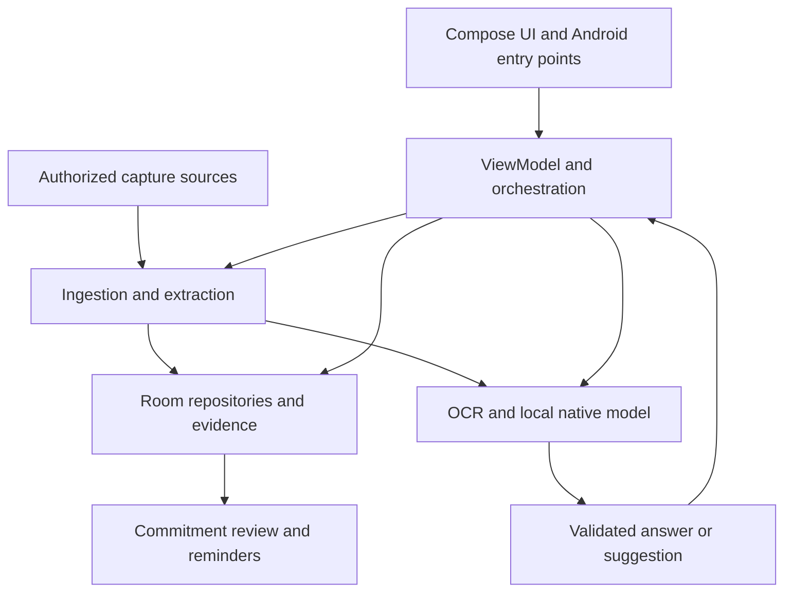

# Architecture

Retenqo is a local-first Android application implemented in Kotlin and Compose. This describes the current architecture and target boundaries, not a claim that every boundary is fully enforced.

| Area | Responsibility |
| --- | --- |
| Presentation | Compose screens, state and user interactions |
| Capture | Notifications, user-started screen capture, explicit picker/share, optional accessibility context |
| Processing | Bounded preprocessing, OCR, deterministic rules, optional local generation |
| Persistence | Room cards, source evidence and commitment history |
| AI runtime | llama.cpp GGUF, Whisper bridge, model lifecycle |
| Scheduling | WorkManager and Android reminder APIs |

The current implementation includes lexical retrieval, rule-first extraction and model-assisted suggestions. The intended direction is clearer domain interfaces, durable ingestion, explicit consent checks, atomic persistence, and lifecycle-safe native runtime ownership. Do not confuse future design with implemented behavior.

See [implementation audit](IMPLEMENTATION_AUDIT.md), [follow-through plan](FOLLOW_THROUGH_PLAN.md), [threat model](THREAT_MODEL.md) and [implementation status](IMPLEMENTATION_STATUS.md).
