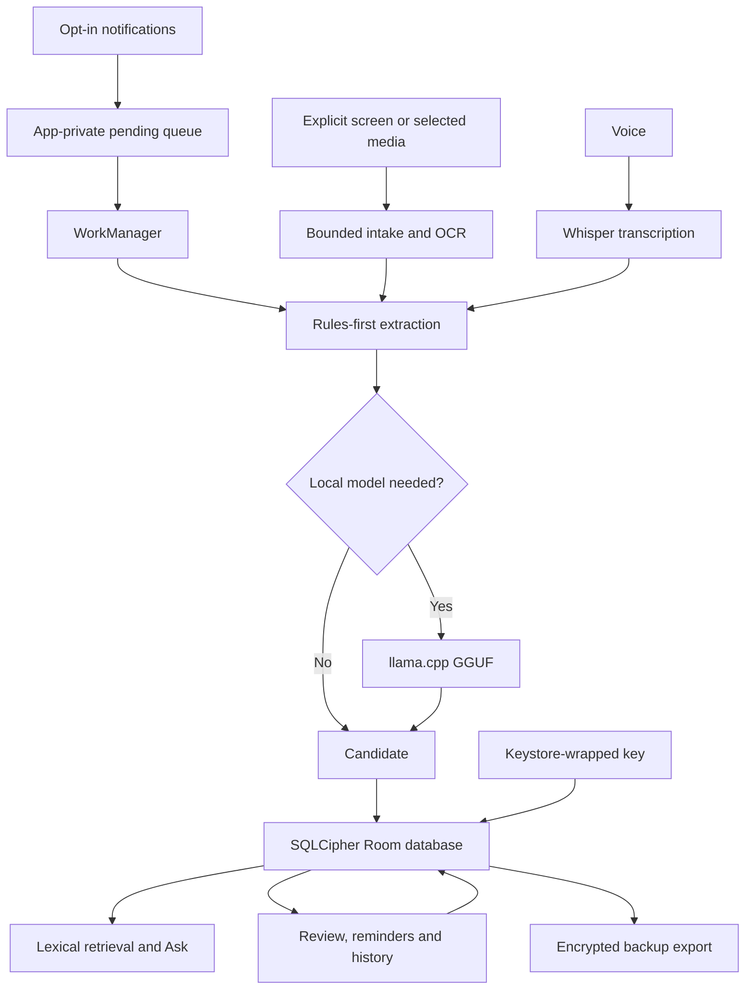
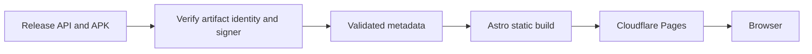

# Architecture

Retenqo is a local-first Kotlin Android app with a static website for product information and verified distribution.

| Component | Responsibility |
| --- | --- |
| Android entry | [MainActivity.kt](../android/mneme/app/src/main/java/com/mneme/app/MainActivity.kt): intents, permissions and manual dependency construction |
| Orchestration | [MnemeViewModel.kt](../android/mneme/app/src/main/java/com/mneme/app/ui/timeline/MnemeViewModel.kt): app operations and state |
| Capture | [MnemeNotificationListener.kt](../android/mneme/app/src/main/java/com/mneme/app/notif/MnemeNotificationListener.kt), [ScreenCapture.kt](../android/mneme/app/src/main/java/com/mneme/app/pulse/ScreenCapture.kt), [MediaIngestPipeline.kt](../android/mneme/app/src/main/java/com/mneme/app/media/MediaIngestPipeline.kt) |
| Processing | [PulsePipeline.kt](../android/mneme/app/src/main/java/com/mneme/app/pulse/PulsePipeline.kt), [RulesExtract.kt](../android/mneme/app/src/main/java/com/mneme/app/ai/RulesExtract.kt), [NoteExtractor.kt](../android/mneme/app/src/main/java/com/mneme/app/ai/NoteExtractor.kt) |
| Persistence | [MnemeDatabase.kt](../android/mneme/app/src/main/java/com/mneme/app/data/MnemeDatabase.kt), [NoteRepository.kt](../android/mneme/app/src/main/java/com/mneme/app/data/NoteRepository.kt), [FollowThroughDao.kt](../android/mneme/app/src/main/java/com/mneme/app/data/FollowThroughDao.kt) |
| AI | [MemoryAsk.kt](../android/mneme/app/src/main/java/com/mneme/app/ai/MemoryAsk.kt), [LlmBridge.kt](../android/mneme/app/src/main/java/com/mneme/app/ai/LlmBridge.kt), [WhisperBridge.kt](../android/mneme/app/src/main/java/com/mneme/app/voice/WhisperBridge.kt) |
| Scheduling | [NotifIngestWorker.kt](../android/mneme/app/src/main/java/com/mneme/app/notif/NotifIngestWorker.kt), [DueReminderScheduler.kt](../android/mneme/app/src/main/java/com/mneme/app/remind/DueReminderScheduler.kt) |
| Recovery | [MnemeBackupManager.kt](../android/mneme/app/src/main/java/com/mneme/app/data/MnemeBackupManager.kt), [BackupCrypto.kt](../android/mneme/app/src/main/java/com/mneme/app/data/BackupCrypto.kt) |

## Decisions and boundaries

- SQLCipher protects Room data at rest; Android Keystore protects its passphrase. Explicit migrations preserve records. The pooled-connection fix retains the SQLCipher-owned array until database close.
- Rules-first processing limits unnecessary inference. Recall uses bounded lexical ranking to select evidence for local generation. [AI implementation](AI_IMPLEMENTATION.md) specifies candidate selection.
- Source context and decision history support reviewable commitments. Completion suggestions require user confirmation.
- Queue bounds and media limits constrain processing. Storage protection boundaries are specified in the [threat model](THREAT_MODEL.md).
- Android permissions, IPC, imported files, native model inputs and output, persistent keys and release publication are trust boundaries.

See [threat model](THREAT_MODEL.md), [AI implementation](AI_IMPLEMENTATION.md) and [implementation status](IMPLEMENTATION_STATUS.md).
